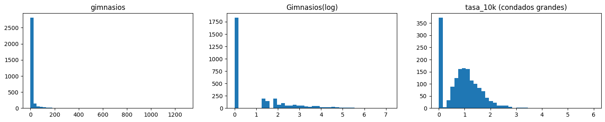
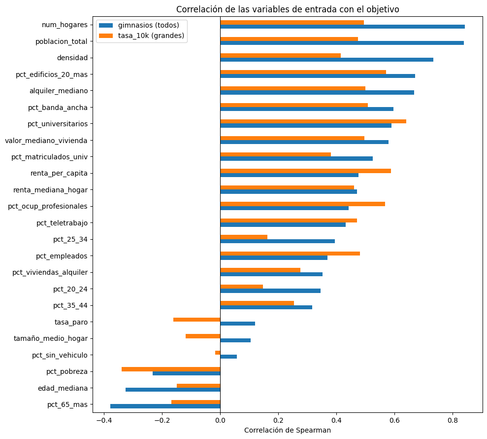
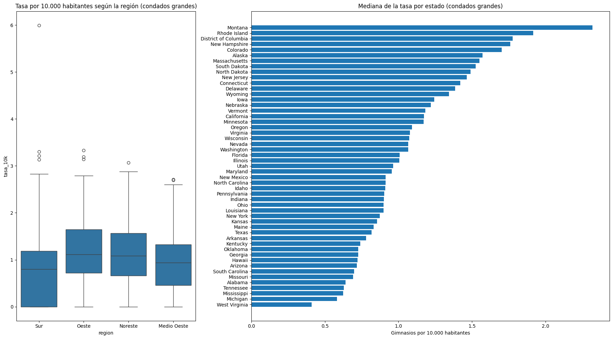

# Estudio de mercado de gimnasios en EE. UU.

Análisis exploratorio de la oferta de gimnasios en los 3.144 condados de Estados Unidos con datos oficiales del U.S. Census Bureau. El objetivo final es detectar zonas con menos gimnasios de los que les corresponderían por su perfil, es decir, posibles huecos de mercado.

> **Estado: en curso.** Este repositorio contiene el análisis exploratorio, la selección de variables y la clusterización. El modelo predictivo es el siguiente paso.

Proyecto individual de la asignatura de Inteligencia Artificial (Grado en Ingeniería Informática, Universidad Europea de Madrid, curso 2026/27).

## Pregunta

¿Qué características de un condado (tamaño, urbanización, renta, nivel educativo, edad...) explican cuántos gimnasios tiene, y en qué condados hay menos oferta de la esperada?

Se estudian dos medidas: el **número de gimnasios** por condado y la **tasa por cada 10.000 habitantes**, que solo se compara en condados de 25.000 habitantes o más porque en los pequeños es muy inestable.

## Datos

Los datos no se incluyen en el repositorio. Todos son públicos y se descargan gratis:

| Fuente | Qué aporta | Archivo | Descarga |
|---|---|---|---|
| County Business Patterns 2023 | Nº de gimnasios por condado (código NAICS 713940, establecimientos con empleados). **Variable objetivo** | `cbp23co.zip` | [cbp23co.zip](https://www2.census.gov/programs-surveys/cbp/datasets/2023/cbp23co.zip) · [página del dataset](https://www.census.gov/data/datasets/2023/econ/cbp/2023-cbp.html) |
| American Community Survey 2020–2024 (5 años), perfiles DP02–DP05 | 542 variables sociales, económicas, de vivienda y demográficas por condado | `DP02.json` … `DP05.json` | API del Census (enlaces abajo) |
| Cartographic Boundary Files 2024, condados 1:500.000 | Superficie de cada condado (para la densidad) y centroides para los mapas | `cb_2024_us_county_500k.zip` | [cb_2024_us_county_500k.zip](https://www2.census.gov/geo/tiger/GENZ2024/shp/cb_2024_us_county_500k.zip) |

Los cuatro archivos de ACS se obtienen de la [API de perfiles de ACS 5 años](https://api.census.gov/data/2024/acs/acs5/profile) y se guardan tal cual con el nombre de la tabla:

```
https://api.census.gov/data/2024/acs/acs5/profile?get=NAME,group(DP02)&for=county:*   ->  data/DP02.json
https://api.census.gov/data/2024/acs/acs5/profile?get=NAME,group(DP03)&for=county:*   ->  data/DP03.json
https://api.census.gov/data/2024/acs/acs5/profile?get=NAME,group(DP04)&for=county:*   ->  data/DP04.json
https://api.census.gov/data/2024/acs/acs5/profile?get=NAME,group(DP05)&for=county:*   ->  data/DP05.json
```

Estructura esperada:

```
data/
├── cbp23co.zip
├── cb_2024_us_county_500k.zip
├── DP02.json
├── DP03.json
├── DP04.json
└── DP05.json
```

## Metodología

1. **Integración** de las tres fuentes por el código FIPS del condado. Se excluye Puerto Rico porque CBP no lo cubre (3.144 condados).
2. **Limpieza**: conversión de tipos, eliminación de columnas constantes y revisión de nulos (solo 11 condados muy pequeños, sin gimnasios).
3. **Selección de variables**: de 542 variables de ACS a 24 por criterio económico, demográfico y geográfico, más la densidad calculada. Tras estudiar la colinealidad quedan **20**.
4. **Transformaciones**: `log(1+x)` en las variables muy asimétricas.
5. **Relación con el objetivo**: correlación de Spearman, diagramas de dispersión y comparación por región y estado (regiones del Censo).
6. **Clusterización K-means** (K = 4, método del codo) sobre las variables escaladas y perfilado de cada grupo.
7. **Mapas interactivos** con plotly de la tasa de gimnasios y de los grupos.

## Resultados principales

**La oferta está muy concentrada.** El 58 % de los condados no tiene ningún gimnasio y el 10 % de los condados concentra casi el 79 %. La varianza es unas 172 veces la media, así que el objetivo es un conteo con exceso de ceros y mucha dispersión.



**El número de gimnasios depende del tamaño; la tasa, del perfil socioeconómico.** Con el número bruto dominan la población, los hogares y la densidad (ρ entre 0,67 y 0,84). Con la tasa por 10.000 habitantes ganan peso el porcentaje de universitarios y la renta per cápita (ρ entre 0,57 y 0,64), y la pobreza resta (ρ = −0,34).



**La región influye, pero menos que el perfil del condado.** La tasa mediana es más alta en el Oeste (1,12) y el Noreste (1,08) y más baja en el Sur (0,80), donde casi el 30 % de los condados grandes no tiene gimnasios. Aun así, hay mucha variación dentro de cada región.



**Cuatro perfiles de condado.** K-means separa un grupo urbano de renta alta (solo el 4 % sin gimnasios), un grupo intermedio y dos grupos rurales donde cerca del 89 % no tiene ninguno: uno envejecido, sobre todo en el Medio Oeste, y otro con más pobreza, sobre todo en el Sur.

**Limitaciones.** CBP solo cuenta establecimientos con empleados. ACS da estimaciones de cinco años con poca precisión en condados pequeños. Las relaciones encontradas son asociaciones, no causas.

## Siguientes pasos

- Modelo de conteo (binomial negativa) para predecir el número de gimnasios de cada condado, comparado con un modelo de árboles.
- Validación agrupando por estado, porque los condados vecinos se parecen entre sí.
- Lista de condados con menos gimnasios de los esperados según su perfil: los posibles huecos de mercado.

## Cómo ejecutarlo

```bash
pip install -r requirements.txt
jupyter notebook Gimnasios_EDA_DanielDeAbajo.ipynb
```

Coloca antes los datos en `data/` como se indica arriba. En Google Colab, descomenta las líneas de montaje de Drive de la primera celda de código y cambia `ruta` a tu carpeta.

Los mapas son interactivos (plotly) y GitHub no los muestra: hay que ejecutar el cuaderno para verlos.

## Herramientas

Python, pandas, NumPy, scikit-learn, geopandas, plotly, seaborn, matplotlib, Jupyter / Google Colab.

## Autor

Daniel De Abajo Nacarino · [LinkedIn](https://www.linkedin.com/in/daniel-deabajo) · [GitHub](https://github.com/danieldeab)
